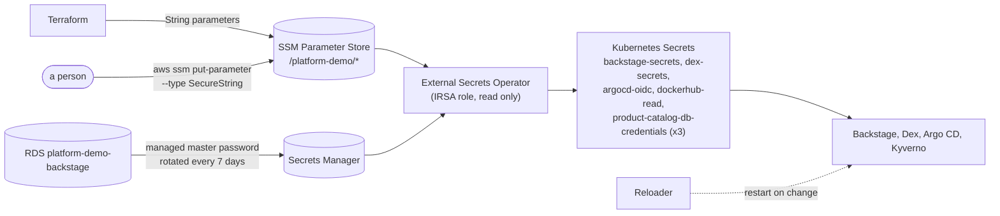

# Secrets

No secret value is in Git. Every secret lives in AWS and **External Secrets Operator** (ESO) turns it into a Kubernetes Secret:



| Piece | File |
|---|---|
| Operator (chart `external-secrets` 2.11.0) | `gitops/layers/security/application-external-secrets.yaml` |
| Stores and ExternalSecrets | chart `external-secrets-config/`, `gitops/layers/security/application-external-secrets-config.yaml` |
| Restart on change (chart `reloader` 2.2.18) | `gitops/layers/security/application-reloader.yaml` |
| Project (sources, namespaces, cluster kinds) | `gitops/apps/appproject-secrets.yaml` |

The operator runs as the ServiceAccount `external-secrets` in the namespace `external-secrets`, both created by Terraform; the account
carries the IAM role that may read SSM `/platform-demo/*` and the RDS master secret, nothing else. The two `ClusterSecretStore`s
(`aws-parameter-store`, `aws-secrets-manager`) sign in with that account's token, and only the namespaces `backstage`, `sso`, `argocd`,
`kyverno` and the three shop namespaces (`platform-demo`, `stage-platform-demo`, `dev-platform-demo`) may use them (`allowedNamespaces`).

## Every SSM parameter

All paths are in `us-east-1`. **Typed** parameters are created once by a person (type `SecureString`); **Terraform** parameters are
written by `infra/terraform` and must not be edited by hand.

| SSM path | Becomes | Consumer | Created by | How to generate |
|---|---|---|---|---|
| `/platform-demo/github-oauth/client-id` | `sso/dex-secrets` `GITHUB_CLIENT_ID` | Dex (GitHub login) | typed | GitHub: organisation settings, *OAuth Apps*, callback `https://dex.platform-demo.click/callback` |
| `/platform-demo/github-oauth/client-secret` | `sso/dex-secrets` `GITHUB_CLIENT_SECRET` | Dex | typed | same OAuth App: *Generate a new client secret* |
| `/platform-demo/sso/argocd-client-secret` | `sso/dex-secrets` `ARGOCD_CLIENT_SECRET` and `argocd/argocd-oidc` `clientSecret` | Dex and Argo CD (same value) | typed | `openssl rand -base64 32` |
| `/platform-demo/sso/backstage-client-secret` | `sso/dex-secrets` `BACKSTAGE_CLIENT_SECRET` and `backstage/backstage-secrets` `BACKSTAGE_OIDC_CLIENT_SECRET` | Dex and Backstage (same value) | typed | `openssl rand -base64 32` |
| `/platform-demo/backstage/auth-session-secret` | `backstage/backstage-secrets` `AUTH_SESSION_SECRET` | Backstage (OAuth handshake session) | typed | `openssl rand -base64 32` |
| `/platform-demo/product-catalog-db/postgres-password` | `platform-demo/product-catalog-db-credentials` `POSTGRES_PASSWORD` (`POSTGRES_DB` and `POSTGRES_USER` are plain values in the same Secret) | the **prod** shop database and product-catalog-service | typed | `openssl rand -hex 32` |
| `/platform-demo/stage/product-catalog-db/postgres-password` | `stage-platform-demo/product-catalog-db-credentials` `POSTGRES_PASSWORD` | the **stage** shop database and product-catalog-service | typed | `openssl rand -hex 32` (a different value than prod) |
| `/platform-demo/dev/product-catalog-db/postgres-password` | `dev-platform-demo/product-catalog-db-credentials` `POSTGRES_PASSWORD` | the **dev** shop database and product-catalog-service | typed | `openssl rand -hex 32` (a different value than prod) |
| `/platform-demo/github/token` | `backstage/backstage-secrets` `GITHUB_TOKEN` | Backstage (catalog discovery, users and teams) | typed | GitHub fine-grained token (or GitHub App) owned by the organisation: read-only *Contents* and *Metadata* on all repositories, *Members* read on the organisation |
| `/platform-demo/dockerhub/username` | `kyverno/dockerhub-read` (username) | Kyverno image-signature verification | typed | the Docker Hub user name |
| `/platform-demo/dockerhub/token` | `kyverno/dockerhub-read` (password) | Kyverno | typed | Docker Hub: *Account settings, Personal access tokens*, permission **Public Repo Read-only** |
| `/platform-demo/rds/backstage/host` | `backstage-secrets` `POSTGRES_HOST` | Backstage | Terraform | (String) RDS endpoint address |
| `/platform-demo/rds/backstage/port` | `backstage-secrets` `POSTGRES_PORT` | Backstage | Terraform | (String) `5432` |
| `/platform-demo/rds/backstage/username` | `backstage-secrets` `POSTGRES_USER` | Backstage | Terraform | (String) `backstage` |
| `/platform-demo/rds/backstage/database` | not read by a chart (Backstage creates one database per plugin) | documentation | Terraform | (String) `backstage` |
| Secrets Manager: the RDS-managed secret of `platform-demo-backstage` (JSON `username`, `password`) | `backstage-secrets` `POSTGRES_PASSWORD` (property `password`) | Backstage | RDS (managed, rotated every 7 days) | none; found by name (`rds!db-*`) by the ExternalSecret, so the random id never reaches Git (needs `secretsmanager:ListSecrets` for the operator role) |
| `/platform-demo/sso/grafana-client-secret`, `/platform-demo/grafana/backstage-token` | only when `grafana.enabled` | Dex client `grafana`, Backstage Grafana card | typed, **only if Grafana is deployed** | `openssl rand -base64 32`; a Grafana service-account token |

Each shop environment reads its own parameter (the list `shop.environments` in `external-secrets-config/values.yaml`; prod keeps the original
path, dev and stage have the environment name in it), so a leaked or rotated dev password says nothing about prod. All three parameters
must exist before the first sync of the security layer finishes, like the others: an ExternalSecret is Healthy only once its Secret exists.
The Secret has the same name in every shop namespace, so the charts need no per-environment setting. A new shop environment adds one
entry to that list and one more SecureString (see [Environments](environments.md)).

Creating a typed parameter (the value never touches a file or the shell history; paste it when asked):

```bash
read -rsp "value: " V && echo
aws ssm put-parameter --region us-east-1 --name /platform-demo/sso/argocd-client-secret \
  --type SecureString --value "$V" && unset V
# or generate it in one go (not printed):
aws ssm put-parameter --region us-east-1 --name /platform-demo/backstage/auth-session-secret \
  --type SecureString --value "$(openssl rand -base64 32)"
```

The Argo CD and Backstage client secrets are used on both sides of the login, which is why each is **one** parameter read by two
ExternalSecrets: change it in SSM, and within an hour (`refreshInterval`) Dex, Argo CD and Backstage all see the new value
(Reloader restarts Dex and Backstage; Argo CD re-reads its Secret).

## Order, and what happens when something is missing

1. Terraform creates the namespace and ServiceAccount `external-secrets` and the parameters it owns.
2. Argo CD syncs `external-secrets` (operator, CRDs) and `reloader` first, then `external-secrets-config` (sync-wave order of the
   app-of-apps; inside that chart the stores are wave 0 and the ExternalSecrets wave 1, and Argo CD waits for the stores to be healthy).
3. The target namespaces (`backstage`, `sso`, `kyverno`, `argocd` and the three shop namespaces) must exist; the Application retries until they do.

Backstage does not crash-loop while its Secret is missing: the Deployment reads every key with `secretKeyRef`, so the pod stays in
`CreateContainerConfigError`, which the kubelet retries by itself (back-off up to five minutes), and starts as soon as the Secret exists.
A typed parameter that does not exist yet leaves the ExternalSecret in `SecretSyncedError` (visible with
`kubectl get externalsecret -A`); the operator retries with back-off, and `kubectl annotate externalsecret <name> -n <ns> force-sync=$(date +%s) --overwrite`
retries at once after you created the parameter.

## RDS password rotation

RDS rotates the master password every seven days in Secrets Manager. `backstage-secrets` is re-read every hour (`refreshInterval: 1h`),
and the Deployment carries `secret.reloader.stakater.com/reload: backstage-secrets`, so Reloader restarts the pod when the value changes.
Worst case, Backstage has a stale password for about an hour after a rotation and reconnects after the restart (the strategy is
`Recreate`: a short outage of the portal). Dex has the same annotation for its `dex-secrets`.

## What the portal image needs

RDS forces TLS and its certificate is signed by the Amazon RDS CA, which is not in the trust store of the (distroless) Node image. The
chart sets `PGSSLMODE=require`; node-postgres turns that into a verified TLS connection (certificate and host name checked) because
the app-config sets no `ssl` option. The image therefore has to trust the RDS CA bundle. In `platform-demo-backstage` (not changed
from here), in the `Dockerfile`:

```dockerfile
# runtime-prep stage: the public AWS RDS trust bundle (pin the checksum when you add it)
RUN curl -fsSL -o /app/rds-global-bundle.pem https://truststore.pki.rds.amazonaws.com/global/global-bundle.pem
# runtime stage
ENV NODE_EXTRA_CA_CERTS=/app/rds-global-bundle.pem
```

`NODE_EXTRA_CA_CERTS` takes one file and is added to the built-in roots, so Dex, GitHub and RDS all verify. The chart does not
override it unless `caConfigMap` is set. No app-config change is required.
