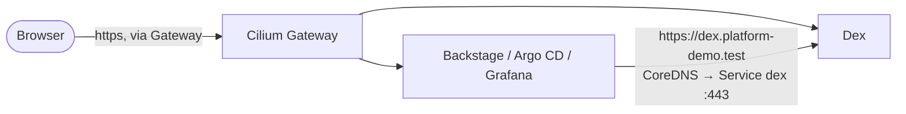

# Single sign-on and the portal

Three things were added to the platform: **Dex** (one login for every UI), **Backstage** (the developer portal) and the wiring that makes
Argo CD and Grafana trust Dex. The portal's own documentation, with the architecture and the decisions, is in the
`platform-demo-backstage` site; this page is what the Helm repository contributes.

Add-ons<strong>dex, backstage</strong><small>envs/dev/addons.yaml</small>

Namespaces<strong>sso, backstage</strong><small>platform scope for Kyverno (audit)</small>

Hosts<strong>dex, backstage</strong><small>.platform-demo.test, via the Gateway</small>

Secrets<strong>Never in Git</strong><small>kind/sso-secrets.sh</small>

## What is where

| Piece | Location |
|---|---|
| Dex chart | `dex/` (ConfigMap, Deployment, Service; in-memory storage) |
| Portal chart | `backstage/` (portal, PostgreSQL, read-only RBAC, PVC for the published docs) |
| Per-environment values | `envs/dev/values/dex.yaml`, `envs/dev/values/backstage.yaml` |
| Routes | `platform-gateway/values.yaml` (`dex`, `backstage`) |
| Argo CD login | `gitops/argocd/values.yaml` (`oidc.config`, `accounts.backstage`, RBAC, CA mount) |
| Grafana login | `monitoring-local/` (`grafana.sso`), `envs/dev/values/monitoring-local.yaml` |
| Kyverno | `policies/values.yaml`: `backstage` and `sso` are platform-scope namespaces; image allow-list gained Dex, PostgreSQL and the portal image |
| Argo CD project | `gitops/apps/appproject-platform.yaml`: destinations `backstage`, `sso` |
| Local bootstrap | `kind/` (below) |

## How a login travels

Browsers reach Dex through the Gateway like any other host. Pods use the same URL: CoreDNS rewrites `dex.platform-demo.test` to
`dex.sso.svc.cluster.local`, whose port 443 is Dex's own HTTPS listener with the wildcard certificate. Each client trusts the local CA from
a ConfigMap (`platform-demo-ca`). The issuer is therefore identical for everyone, which OIDC requires.

## The local bootstrap

| Script | Does |
|---|---|
| `kind/up.sh` | Adds the CoreDNS rewrite; calls the scripts below in order |
| `kind/sso-secrets.sh` | Namespaces, CA ConfigMaps, Dex TLS Secret, random client secrets, the demo user |
| `kind/local-source.sh` | `LOCAL_SOURCE=1`: serves this working tree to Argo CD as a Git remote and the catalog descriptors over HTTP (nothing is pushed) |
| `kind/load-image.sh` | Puts the locally built portal image into the node |
| `kind/sso-bootstrap.sh` | Creates the read-only Argo CD account token and Grafana service-account token the portal uses |
| `kind/techdocs-publish.sh` | Renders every repository's docs and copies them into the portal |

!!! warning "Secrets"
    Nothing secret is in Git. Client secrets, the demo password, tokens and the database password are generated on the machine
    and stored in cluster Secrets (and `kind/certs/demo-password`, which is git-ignored).

## Switching on the real GitHub login

See the portal documentation (*Single sign-on → Going live with GitHub*). In this repository it is two lines in
`envs/dev/values/dex.yaml` (`github.enabled: true`, `demoUser.enabled: false`) plus the OAuth App's id and secret in the `dex-secrets` Secret.
