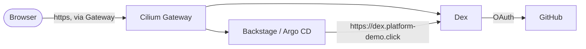

# Single sign-on and the portal

Three things were added to the platform: **Dex** (one login for every UI), **Backstage** (the developer portal) and the wiring that makes
Argo CD trust Dex. The portal's own documentation, with the architecture and the decisions, is in the
`platform-demo-backstage` site; this page is what the Helm repository contributes.

Add-ons<strong>dex, backstage</strong><small>envs/dev/addons.yaml</small>

Namespaces<strong>sso, backstage</strong><small>platform scope for Kyverno (audit)</small>

Hosts<strong>dex, backstage</strong><small>.platform-demo.click, via the Gateway</small>

Secrets<strong>Never in Git</strong><small>AWS SSM, see <a href="../secrets/">Secrets</a></small>

## What is where

| Piece | Location |
|---|---|
| Dex chart | `dex/` (ConfigMap, Deployment, Service, RBAC; state in Kubernetes custom resources, not `memory`) |
| Portal chart | `backstage/` (portal on Amazon RDS PostgreSQL, read-only RBAC, PVC for the published docs) |
| Per-environment values | `envs/dev/values/dex.yaml`, `envs/dev/values/backstage.yaml` |
| Secrets | `external-secrets-config/` (ExternalSecrets), `gitops/layers/security/application-external-secrets.yaml`, [Secrets](secrets.md) |
| Routes | `platform-gateway/values.yaml` (`dex`, `backstage`) |
| Argo CD login | `gitops/argocd/values.yaml` (`oidc.config`, `admin.enabled: "false"`, RBAC) |
| Kyverno | `policies/values.yaml`: `backstage` and `sso` are platform-scope namespaces; image allow-list has Dex and the portal image |
| Argo CD projects | `gitops/apps/appproject-platform.yaml` (backstage, sso), `appproject-secrets.yaml` (operators) |

## How a login travels

Browsers and pods use the same public URL for Dex, with a publicly trusted certificate (ACM) terminated at the ALB, so no pod needs a
private CA and the issuer is identical for everyone, which OIDC requires. Dex signs people in with their GitHub account (only members of
the `platform-boutique` organisation) and passes their teams on as groups.

## The portal's database

Backstage keeps its state in the RDS PostgreSQL instance `platform-demo-backstage` (Multi-AZ, created by Terraform), not in the cluster.

| Item | How |
|---|---|
| Endpoint, port, user | SSM String parameters `/platform-demo/rds/backstage/{host,port,username}` written by Terraform, copied by External Secrets into `backstage-secrets` |
| Password | Secrets Manager secret managed by RDS (rotated every 7 days); External Secrets re-reads it every hour, Reloader restarts the pod when it changes |
| Encryption | RDS forces SSL; the pod sets `PGSSLMODE=require`, and the image trusts the AWS RDS CA bundle (`NODE_EXTRA_CA_CERTS`) |
| Network | Security group of the instance allows the cluster; the optional `networkPolicy` of the chart allows egress to the VPC CIDR on 5432 |

Until `backstage-secrets` exists the pod waits in `CreateContainerConfigError`; the kubelet retries by itself, so there is no crash loop and
the portal starts as soon as External Secrets has created the Secret.

!!! warning "Secrets"
    Nothing secret is in Git. Every value the charts need is an SSM parameter or the RDS-managed secret; [Secrets](secrets.md) lists each
    one, who reads it and how to create it. There are no local passwords: Argo CD has no local accounts and Dex has no demo user.

## The real GitHub login

`github.enabled: true` is the default (`envs/dev/values/dex.yaml`; the chart refuses to render without it). The OAuth App of the
organisation (callback `https://dex.platform-demo.click/callback`) provides the id and secret that go to SSM
(`/platform-demo/github-oauth/*`). See the portal documentation (*Single sign-on → Going live with GitHub*).
