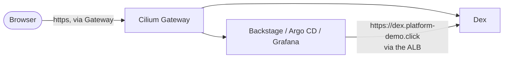

# Single sign-on and the portal

Three things were added to the platform: **Dex** (one login for every UI), **Backstage** (the developer portal) and the wiring that makes
Argo CD and Grafana trust Dex. The portal's own documentation, with the architecture and the decisions, is in the
`platform-demo-backstage` site; this page is what the Helm repository contributes.

Add-ons<strong>dex, backstage</strong><small>envs/dev/addons.yaml</small>

Namespaces<strong>sso, backstage</strong><small>platform scope for Kyverno (audit)</small>

Hosts<strong>dex, backstage</strong><small>.platform-demo.click, via the ALB and the Gateway</small>

Secrets<strong>Never in Git</strong><small>SSM Parameter Store + External Secrets</small>

## What is where

| Piece | Location |
|---|---|
| Dex chart | `dex/` (ConfigMap, Deployment, Service, RBAC; state in Kubernetes custom resources, not `memory`: see the gotcha in the handoff) |
| Portal chart | `backstage/` (portal, PostgreSQL, read-only RBAC, PVC for the published docs) |
| Per-environment values | `envs/dev/values/dex.yaml`, `envs/dev/values/backstage.yaml` |
| Routes | `platform-gateway/values.yaml` (`dex`, `backstage`) |
| Argo CD login | `gitops/argocd/values.yaml` (`oidc.config`, `admin.enabled: "false"`, RBAC) |
| Grafana login | Dex client `grafana` (`dex/values.yaml`); Grafana itself is not deployed by `envs/dev` yet |
| Kyverno | `policies/values.yaml`: `backstage` and `sso` are platform-scope namespaces; image allow-list gained Dex, PostgreSQL and the portal image |
| Argo CD project | `gitops/apps/appproject-platform.yaml`: destinations `backstage`, `sso` |

## How a login travels

Browsers and pods use the same URL, `https://dex.platform-demo.click`: TLS ends at the ALB (ACM certificate) and the Gateway forwards plain HTTP to
the `dex` Service. The issuer is therefore identical for everyone, which OIDC requires.

!!! warning "Secrets"
    Nothing secret is in Git. Client secrets, tokens and passwords are values in AWS Systems Manager Parameter Store that External Secrets
    turns into the cluster Secrets (`sso/dex-secrets`, `backstage/backstage-secrets`, `argocd/argocd-oidc`). There are no local passwords: Argo CD has no local accounts, Grafana's login form is off and Dex has no demo user.

## Switching on the real GitHub login

See the portal documentation (*Single sign-on → Going live with GitHub*). In this repository `github.enabled: true` is the default
(`envs/dev/values/dex.yaml`; the chart refuses to render without it), and the OAuth App's id and secret go into the `dex-secrets` Secret (parameters `/platform-demo/github-oauth/client-id` and `client-secret`).
